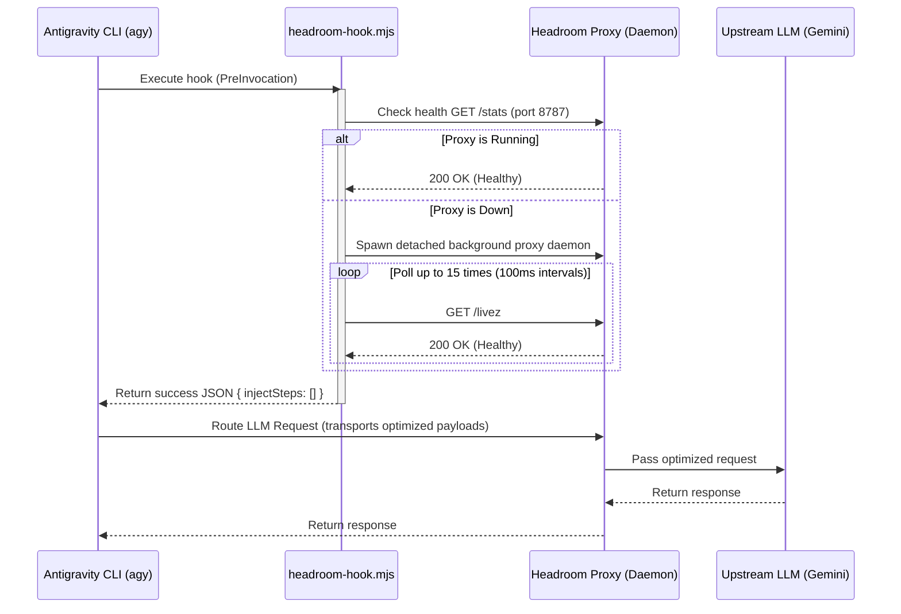

# agy-headroom - Design Specification: Transparent Context Optimisation

This specification details the technical architecture for the `agy-headroom` Antigravity plugin. The primary goal is to ensure the Headroom context optimisation proxy starts automatically and runs transparently in the background of any active Google Antigravity CLI (`agy`) session, without user prompts or manual steps.

## 1. System Architecture

The plugin integrates into the `agy` execution lifecycle via the `PreInvocation` hook, running a lightweight Node.js script before each model call.



## 2. Component Specifications

### 2.1 Hook Script (`scripts/headroom-hook.mjs`)
The Node.js hook script implements the following logic:
1. **Health Check**: Connect to `http://127.0.0.1:8787/stats` (or custom `$HEADROOM_PORT`) using a 200ms socket timeout.
2. **Subprocess Spawning**: If the health check fails, spawn the `headroom proxy` command:
   - Configured with `detached: true` to prevent the proxy from terminating when the hook script exits.
   - Outputs redirected using `stdio: 'ignore'` to avoid blocking the parent execution pipe.
   - Command: `headroom proxy --port 8787 --backend litellm-vertex` (or standard passthrough depending on configuration).
3. **Readiness Polling**: Poll `http://127.0.0.1:8787/livez` or `/stats` every 100ms for up to 1.5 seconds.
   - If the proxy becomes healthy, return `{ injectSteps: [] }` immediately.
   - If the timeout expires without a healthy response, log a warning message to the console and allow the session to proceed unoptimised.

### 2.2 Configuration Manifests

#### `plugin.yaml`
Registers capabilities and hooks:
```yaml
name: agy-headroom
version: 0.1.0
description: Google Antigravity plugin to optimise context windows with Headroom.
provides_skills:
  - headroom
provides_commands:
  - headroom
  - headroom-status
  - headroom-savings
  - headroom-memory
  - headroom-dashboard
provides_hooks:
  - PreInvocation
```

#### `hooks.json`
Specifies hook mapping:
```json
{
  "headroom-hook": {
    "PreInvocation": [
      {
        "type": "command",
        "command": "./scripts/headroom-hook.mjs"
      }
    ]
  }
}
```

## 3. Security and Hardening

- **Shell Injection Prevention**: The proxy is spawned directly via `child_process.spawn` using an array of arguments rather than a raw shell string, eliminating shell injection vectors.
- **Port Conflicts**: If the target port is occupied by a non-Headroom service, the hook script will fail to detect a healthy status and fall back gracefully, avoiding system hangs.

## 4. Verification and Testing

1. **Unit Verification**:
   - Write a test script `tests/headroom-hook.test.mjs` that stub-mocks the `http` request and verify background subprocess spawning.
2. **Integration Verification**:
   - Stop any active headroom proxy processes.
   - Run `agy --print "hello"` to trigger the `PreInvocation` hook.
   - Verify the Headroom proxy process was automatically spawned in the background and is active on port `8787`.
